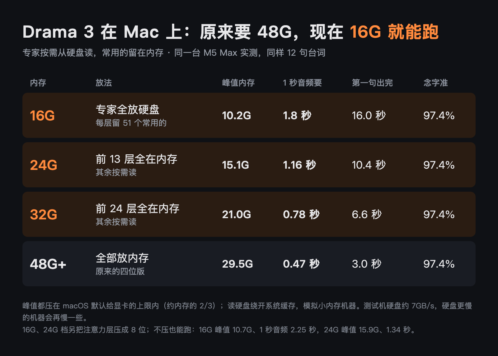

# Drama 3 by memory size — experts on demand (2026-11-24)



Same machine for every row (Apple M5 Max, 128 GB, internal SSD ~7 GB/s), same frozen set
(6 Mandarin lines × seeds 1234/5678), 4-bit experts (release v0.1.0-int4).

| Mac memory | Budget used ¹ | Layout | Peak (MLX) | First line | Speed (RTF) | Char acc | vs resident |
| --- | --- | --- | --- | --- | --- | --- | --- |
| **16 GB** | 10.7 GB | all experts on SSD, 51 slots/layer, dense int8 | **10.24 GB** | 16.0 s | **1.80** | 0.974 | mel 2.3 dB ² |
| 16 GB (exact) | 10.7 GB | all experts on SSD, 26 slots/layer | 10.65 GB | 18.6 s | 2.25 | 0.974 | same codes ³ |
| **24 GB** | 16 GB | first 13 layers resident, 62 slots, dense int8 | **15.12 GB** | 10.4 s | **1.16** | 0.974 | mel 2.3 dB ² |
| 24 GB (exact) | 16 GB | first 9 layers resident, 62 slots | 15.90 GB | 12.0 s | 1.34 | 0.974 | same codes ³ |
| **32 GB** | 21.3 GB | first 24 layers resident, 74 slots | **21.01 GB** | 6.6 s | **0.78** | 0.974 | same codes ³ |
| **48 GB+** | 36 GB | everything resident (4-bit build) | **29.47 GB** | 3.0 s | **0.47** | 0.974 | — |

¹ macOS's default GPU working set: about 2/3 of RAM up to 32 GB, 3/4 above. Each run sets
`mx.set_memory_limit` to that budget, keeps the MLX buffer cache at 0, and reads experts with
`F_NOCACHE`, so the test machine's page cache never serves a miss (a real 16 GB Mac has no room
for one). This is a simulation on a 128 GB machine, not a 16 GB Mac; a slower SSD will be slower.

² `dense_int8` (already in mlx-speech) packs attention / shared-expert / audio-decoder projections
as int8. Mel distance to the resident build 2.3 dB, below the same build's own seed-to-seed
spread (2.2–2.4 dB); char accuracy unchanged.

³ Same sampled codes; the waveform differs by at most 1 LSB in 7 of 12 files from the codec's
smaller decode tiles (64 instead of 256 steps, cuts the decode peak 3.5 → 1.8 GB).

## How it works (copied from people who did it first)

- [flash-moe](https://github.com/danveloper/flash-moe) and
  [AiiStream Q3.6](https://github.com/apirathaiya/aiistream-q3.6) (Qwen3.6-35B-A3B on a 16 GB M5 —
  the same 40-layer, 256-expert, top-8 backbone Drama 3 uses): leave the routed experts in the
  stock safetensors, `pread` only the 8 the router picks, with 8 reader threads.
- Expert reuse is very uneven by depth (replay of the trace, 64 slots: layer 0 hits 32%,
  layer 30 hits 98%), so the leading layers are pinned whole and the rest get LRU slots.
  `plan_tiers.py` picks pinned layers / slots for a budget from `results/lowmem/int4-trace`.
- Tried and dropped: AiiStream's next-layer prefetch (next router on this layer's input) —
  guessed 33% of Drama 3's picks, 5% slower overall.

## Reproduce

```sh
cd harness
echo '{"id":"g16","build":"int4","knobs":{"pin_layers":0,"slots":51,"dense_int8":true,"cache_limit_gb":0,"memory_limit_gb":10.7},"src":"src-base"}' > g16.json
../.venv/bin/python -I bench.py g16.json runs/g16
```

Raw `stats.json` / `quality.json` for every row are in this folder.
